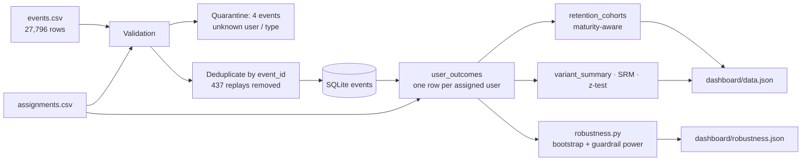

# Experiment Lab

A product team tested a guided onboarding flow. More users activated, by a statistically significant margin. I recommended **not** shipping it, because support contacts went up well past the limit agreed before the test. This repository is the full analysis: event cleaning, user-level SQL marts, the statistics, and a second pass that checks whether the result holds up.

**Stack:** Python (standard library), SQL (SQLite), GitHub Actions
**Data:** a generated randomized experiment (seed 418, 12,000 users, September–October 2026). The effects are built into the simulation, so the analysis method is real but the product result isn't.
**Dashboard:** [project page](https://beyzamercanse.github.io/project1/work/experiment-lab.html) · or open `dashboard/index.html` locally

## Result

| | Control | Treatment | Difference (95% CI) |
|---|---:|---:|---:|
| Users | 6,035 | 5,965 | SRM p = 0.52 |
| 7-day activation | 27.47% | 31.00% | **+3.52 pp** (+1.90 to +5.15) |
| 7-day support contact | 3.76% | 6.02% | **+2.26 pp** (+1.49 to +3.03) |

Decision rule, written before the analysis: ship only if activation improves by at least 1.5 pp **and** the upper bound of the support increase stays at or below +0.5 pp. Activation passes, the guardrail fails, so the decision is **hold**.

## Architecture



## How it works

**Denominator first.** Every rate is divided by *assigned* users, not exposed users (intent-to-treat). 4.5% of users never saw onboarding. Dropping them would quietly turn a randomized comparison into a self-selected one.

**Events to users.** Events are deduplicated by ID before any join, then collapsed to one row per user with `MAX(CASE ...)` flags. A user who fires `first_value` three times still counts once. One test feeds duplicate events through the SQL and checks the user-level result directly.

**Windows.** "7-day" means offsets 0–6 from the assignment date. D30 retention only includes users with 30 observed days; for younger cohorts it is `NULL` ("not mature"), never 0%. A zero there would look like churn.

**Checks before the decision.** Sample-ratio mismatch (chi-square against 50/50), a complete primary window for every user, and a raw-event audit: 27,796 = 27,355 accepted + 437 duplicates + 4 quarantined.

## Second pass: does the conclusion hold up?

After the first version I went back with two questions (`scripts/robustness.py`, write-up in [docs/robustness.md](docs/robustness.md)).

**1. Is the normal approximation hiding anything?** I bootstrapped the lifts by resampling users within each arm (2,000 resamples, seeded).

| | Wald 95% CI | Bootstrap 95% CI |
|---|---|---|
| Activation lift | +1.90 to +5.15 pp | +1.85 to +5.15 pp |
| Support increase | +1.49 to +3.03 pp | +1.51 to +3.01 pp |

No. With counts in the hundreds the two agree, and the hold doesn't depend on the method.

**2. Could this test have passed the guardrail at all?** This turned out to be the more useful question. With a 3.76% support baseline and about 6,000 users per arm, a treatment with *zero* effect on support would pass the +0.5 pp rule only **30%** of the time. I checked that formula by simulating 1,000 harmless experiments through the same rule: also 30%. Getting to 80% power at that margin needs about **22,730 users per arm**. At the current size, the tightest margin you can reliably clear is about +1.0 pp.

So the hold is right for this result, because the harm is large. But the guardrail as designed would also have blocked most harmless changes. For the next test I'd fix the sample size or the margin with the support team *before* running it.

## Run it

```sh
python3 scripts/pipeline.py               # fixtures → SQLite → marts → data.json + case study
python3 scripts/robustness.py             # bootstrap and power check (~2 s)
python3 -m unittest discover -s tests -v  # 20 tests
python3 scripts/check_evidence.py         # regenerated outputs match the committed ones
python3 dashboard/refresh.py              # update the offline dashboard's data.js
```

No packages, keys or network access needed.

## Repository layout

```text
scripts/pipeline.py        fixture generator, ingestion, statistics, export
scripts/robustness.py      bootstrap intervals, guardrail power, simulation check
scripts/check_evidence.py  CI check that committed results are reproducible
sql/marts.sql              user_outcomes, variant_summary, retention_cohorts
tests/                     statistics, SQL windows, ITT, SRM, rerun, robustness
docs/                      analysis plan, metric catalog, architecture, case study, robustness
dashboard/                 static dashboard built from the JSON outputs
```

## Limits

Segments and retention are exploratory, and I don't make subgroup claims from them. The simulation has no interference between users. Real collaborative workspaces might need account-level randomization. The data can't say *why* support contacts rose. That needs step-level instrumentation and support ticket reasons, which is the first thing I'd add before rerunning.

MIT licensed.
