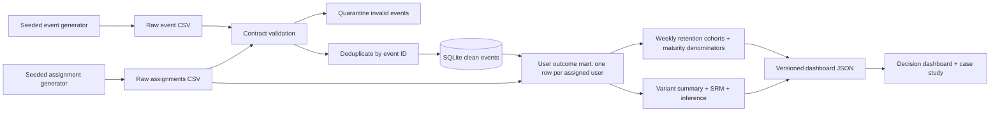
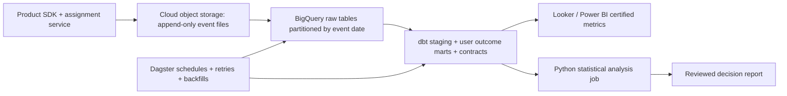

# Architecture and project design

## Implemented local system

**Runtime:** Python 3.9+ and SQLite. The only external system needed for CI is GitHub Actions after publication. The dashboard is separate from the pipeline and only reads the exported JSON; no chart value is typed in by hand.

## Grains and contracts

| Object | Grain / key | Contract |
|---|---|---|
| assignments | one randomized user / user_id | unique user, control or treatment, assignment date and segment present |
| events | one event / event_id | known event type, user references an assignment; repeated event IDs ignored |
| quarantine | one rejected input event | reason and event ID retained; not silently discarded |
| user_outcomes | one randomized user / user_id | LEFT JOIN preserves non-exposed users; binary outcomes use MAX |
| variant_summary | one variant | outcome counts and observation eligibility; assigned-user denominator |
| retention_cohorts | assignment week × variant | separate D7/D30 eligible counts and successes; zero eligible gives null rate |

Raw fixture creation guarantees ISO dates; this local generator is not an arbitrary external-feed parser. A production contract must also reject malformed timestamps, conflicting duplicates, events before assignment, and identity changes. These are explicitly out of scope for the fixture ingestion.

## Failure and correctness behaviors

- Primary-key assignment validation and foreign keys stop contradictory user identities.
- Replayed event IDs are removed before SQL; invalid type and unknown-user events are quarantined.
- A left join followed by binary aggregation prevents selection and join-multiplicity mistakes.
- A complete primary outcome window is required before a launch recommendation.
- A 50/50 allocation SRM p-value below 0.001 blocks launch. SRM passing is necessary but not sufficient for trustworthy randomization.
- Raw count equals accepted + duplicate + rejected count. The audit is exported with every dashboard build.
- Rerunning produces identical analytical JSON. There is no streaming, backfill orchestrator, or production monitoring claim.

## Proposed production extension — not deployed

The architecture uses one warehouse and one orchestrator. A real implementation would add event-time/ingest-time fields, assignment-service logs independent of exposure, a late-arrival policy, consent-aware user identifiers, model versioning, a metric owner, and an alert for assignment imbalance. Load source partitions idempotently and rerun affected experiment windows when late events arrive. None of this needs personal data.

## Acceptance criteria

- A fresh checkout reproduces the decision and interval with one Python command.
- All meaningful tests pass, including a biased allocation and immature retention cohort.
- Every displayed result is labelled as simulated and can be traced to SQL and source fields.
- The decision can be explained from the README and case study without reading the code.
- `scripts/robustness.py` reproduces the bootstrap and power results from the same database.
